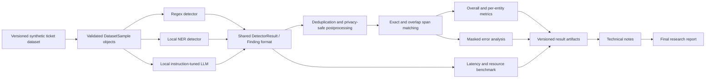

# Enterprise Sensitive Data Evaluation

This project is a research-engineering framework for evaluating sensitive-data
detectors on synthetic enterprise ticket-style text. The v1 compares a
deterministic regex baseline with later NER and local LLM detectors using a
shared span-based output format.

## Intended Architecture



## Dataset Format

Synthetic samples are stored as JSONL, with one labelled enterprise text sample
per line. Each sample contains raw text, source type, optional
difficulty/metadata, and labelled sensitive spans using inclusive-start,
exclusive-end character offsets.

See `docs/dataset_schema.md` for the full schema and validation rules.

## Synthetic Dataset

40 synthetic samples that mimic realistic enterprise text sources are generated
and validated. A dataset table plan was first built before the dataset was
generated to ensure balance across source types, entity types, and difficulty
levels.

See `docs/dataset_plan.md` for the full dataset plan.

The dataset simulates enterprise text sources such as support tickets, internal
comments, change requests, operational notes, config snippets, and attachment
texts. Each source type appears at least 5 times in the dataset.

See `data/synthetic_samples.jsonl` for the full generated dataset.

## Regex Detector Baseline

A deterministic regex detector has been added in
`sensitive_eval/detectors/regex_detector.py`. The detector uses a small
`RegexRule` dataclass to keep each rule's pattern, entity type, confidence
score, optional named capture group, and rule ID together.

The detector currently covers:

- email addresses
- IPv4 addresses
- AWS/access-key-like strings
- contextual password disclosures such as `password is Winter2026!`
- token-like secrets such as `sk_live_...`, `ghp_...`, `sess_...`, and
  `*_tok_...`

Each detector run returns one `DetectorResult` for the sample. Individual
matches are stored as `Finding` objects with a `TextSpan`, `EntityType`,
detector name, confidence score, masked value, and rule ID. Raw matched values
are used only transiently for masking and are not stored in detector output.

Example output shape:

```python
DetectorResult(
    sample_id="sample-002",
    detector_name="regex",
    findings=(
        Finding(
            span=TextSpan(start=56, end=80),
            entity_type=EntityType.TOKEN,
            detector_name="regex",
            confidence_score=0.88,
            masked_value="sk**********************",
            rule_id="token_like_secret",
        ),
    ),
)
```

Regex is strongest for structured, repeated formats such as emails, IPv4
addresses, cloud keys, and token-like strings. Expected blind spots include
person names, ambiguous account identifiers, secrets described without clear
keywords, and sensitive values whose format differs from the current synthetic
patterns. 

## Verification

Current test snapshot:

```bash
.venv/bin/pytest --tb=short
```

Result: `33 passed`.
