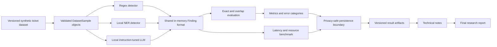

# Technical Note 1: Evaluation Protocol v0.1

## Purpose

This project evaluates methods for detecting sensitive content in synthetic
enterprise ticket-style text. It is intended to support the design of secure,
dependable, and auditable AI systems for regulated or high-consequence
environments.

In this project, **sensitive content** is a text span that could identify a
person, account, or operational system, or could enable unauthorised access if
disclosed. The v1 taxonomy covers three broad groups:

- personal data: names, email addresses, and phone numbers;
- operational identifiers: IP addresses and account identifiers;
- authentication secrets: passwords, tokens, and access keys.

Sensitivity is sometimes contextual rather than intrinsic. For example, an IP
address identifying an internal production host is labelled sensitive, while
an IP address explicitly presented as a generic documentation example can be a
hard negative. The entity-specific policy below determines which candidate
spans receive labels.

## Research questions

Three primary detector families are compared under privacy-preserving,
resource-constrained, and auditable deployment assumptions:

- deterministic regex/rule-based detection;
- local model-based named entity recognition (NER);
- prompt-based detection using a local instruction-tuned large language model
  (LLM).

A derived union or hybrid of regex and NER may also be evaluated, but it is not
one of the three primary baselines.

### RQ1: Complementary value of NER

What complementary coverage does model-based NER add to deterministic rules
for contextual personal data, particularly person names, and what boundary,
classification, and contextual false-positive modes does it introduce?

### RQ2: Incremental value of a local LLM

How much detection-quality improvement does a local instruction-tuned LLM
provide beyond regex, NER, and their union, and what latency, resource,
reproducibility, and determinism costs accompany that improvement?

## Hypotheses

- **H1:** Regex rules will achieve higher precision on rigidly formatted
  entities such as email addresses, IP addresses, prefixed tokens, and access
  keys, but lower recall on variable and contextual entities.
- **H2:** NER will improve recall for person names and other contextual personal
  data while introducing additional boundary errors, label confusion, and
  false positives under domain shift.
- **H3:** A local instruction-tuned LLM will recover some contextual sensitive
  spans missed by regex and NER, but will have higher latency, greater resource
  requirements, and more variable or invalid outputs.

These are testable expectations, not assumed conclusions.

## Model selections

The v1 NER baseline will use `nvidia/gliner-PII`. The model repository revision,
GLiNER package version, label mapping, and confidence threshold must be pinned
in the experiment configuration. The current candidate revision is
`2d732f15473c43dc5c62d4e491383ef81254a9f4`; the final run will record the
revision actually resolved by the runtime.

The local LLM has not yet been frozen. Candidate models and a development-set
selection rule must be documented before comparing candidates. The held-out
test split cannot be used for model selection.

## Scope and entity annotation policy

The included `entity_type` values are:

- `email`
- `phone_number`
- `ip_address`
- `person_name`
- `account_identifier`
- `access_key`
- `token`
- `password`

The following table gives the initial v1 labelling policy. It will be refined
when ambiguous examples are found during development-set annotation.

| Entity | Label when | Do not label when |
| --- | --- | --- |
| Email | It is presented as a person's contact or account address. | A field name is present without a value. |
| Phone number | It identifies a customer, employee, or operational contact. | It is incomplete or explicitly described as a formatting example. |
| IP address | It identifies a host, endpoint, or operational system in the ticket. | It is explicitly a generic documentation example. |
| Person name | It identifies a customer, employee, approver, owner, or responder. | It is a generic placeholder such as `First Last`. |
| Account identifier | It identifies a customer, user, or service account. | It is only a field name, schema example, or redacted placeholder. |
| Access key | A credential-like value is disclosed as active, copied, configured, or requiring rotation. | It is redacted or explicitly a non-functional placeholder. |
| Token | A token-like value is disclosed as active, copied, configured, or requiring rotation. | It is redacted or explicitly a non-functional placeholder. |
| Password | A password value is disclosed. | The text only discusses a password action, such as resetting it, without revealing a value. |

Because the dataset is synthetic, safe reserved values can represent the role
of real sensitive values. A value is therefore not treated as benign merely
because it uses a reserved domain or deliberately non-functional credential.
The ticket's intended semantics determine its label.

Organisation names are excluded from v1. Determining whether an organisation
mention identifies a confidential customer, partner, project, or relationship
requires contextual sensitivity classification beyond ordinary NER. This is
reserved for future work.

## Regex boundary guards and limitations

The regex baseline uses format and boundary guards to reduce partial matches
and obvious false positives. A boundary guard defines which characters may
appear immediately before or after a candidate. It is distinct from the gold
annotation policy: the guard controls detector behaviour, while the annotation
policy defines the correct span against which that behaviour is evaluated.

The current rules implement the following protections and limitations:

| Entity | Implemented guards | Known limitations |
| --- | --- | --- |
| Email | Requires a local part, `@`, one or more domain labels, and outer boundaries based on email-like characters. Surrounding ticket punctuation is excluded. | This is intentionally not full RFC email validation. Numeric final domains and some malformed local parts, including consecutive or terminal dots, may still match. Format alone cannot determine whether an address is sensitive in context. |
| IPv4 address | Validates four octets in the range 0--255, prevents matching inside a word or as part of a longer dotted numeric sequence, and allows ordinary sentence punctuation after the address. | IPv6 is unsupported. A syntactically valid IP used only as a documentation example is indistinguishable by shape from an operational host; sensitivity requires contextual logic or an explicit dataset policy. |
| AWS-style access key | Requires a known prefix (`AKIA`, `ASIA`, `AIDA`, or `AROA`) followed by 16 uppercase letters or digits, with outer alphanumeric boundaries. | Other cloud providers and unknown key formats are missed. A valid-looking placeholder cannot reliably be distinguished from a disclosed key by format alone. The trailing boundary should be verified against lowercase suffixes. |
| Password | Uses explicit password cues and separators, supports configuration keys such as `DB_PASSWORD`, separates quoted and unquoted values, excludes surrounding quotes, and rejects several common non-values such as `required`, `unknown`, and `redacted`. | The exclusion vocabulary is necessarily incomplete. Natural-language statements can still be misclassified, and punctuation at the end of an unquoted password can be inherently ambiguous. Password disclosures without a recognised cue are missed. |
| Token | Requires one of the supported token prefixes, constrains the token alphabet and length, and prevents matches embedded in a larger token-like identifier. | Unknown or prefix-free tokens are missed. A documented placeholder that follows a supported format cannot be classified as benign from shape alone. |
| Phone number | Requires 7--15 digits, permits a leading `+` and common spaces, parentheses, or hyphens, excludes surrounding word characters, and rejects ISO dates of the form `YYYY-MM-DD`. | A bare numeric account, build, order, or ticket ID can have the same shape as a phone number. Distinguishing these requires nearby phone-related context, a post-match guard, or dataset policy. Other date formats and extensions are not yet handled. |

The v1 regex baseline does not attempt person-name detection. Account
identifiers also remain unsupported until their accepted formats can be defined
without introducing an overly broad alphanumeric rule.

These limitations are part of the experimental design rather than problems to
hide. Format-level guards should handle invalid structure, embedded substrings,
and clear delimiters. They should not be expanded indefinitely to imitate
semantic reasoning. Ambiguous but well-formed cases will be represented in the
development and held-out datasets so that the comparison can measure what NER
and a local LLM add beyond deterministic rules.

## Dataset design

The current development dataset contains 40 labelled synthetic samples in
JSONL format. It covers seven source types and all eight included entity types.
The canonical fields, validation rules, and JSON examples are defined in
[`dataset_schema.md`](dataset_schema.md).

The dataset will be expanded carefully towards approximately 120 samples. Its
challenge categories will include:

- easy, rigidly structured entities;
- contextual sensitive data;
- ambiguous examples;
- benign strings resembling secrets;
- multiple entities in one ticket;
- overlapping or adjacent entities;
- malformed operational text;
- short configuration snippets;
- realistic but synthetic ticket language.

Challenge categories are tags rather than mutually exclusive partitions. A
ticket can contain both a true sensitive span and a hard-negative string.

### Positive and negative evidence

A **positive sample** contains at least one labelled sensitive span. A
**completely negative sample** contains zero sensitive labels and tests whether
a detector can remain silent. A **hard negative** is a benign span that
resembles a sensitive entity, such as a documented placeholder, a field name
without a value, or an ordinary identifier resembling a token. Hard negatives
can occur in either positive or completely negative tickets.

For a dataset of approximately 120 samples, the initial target is roughly
80--90 samples with at least one sensitive span and 30--40 zero-label samples.
At least 25--35 samples should contain one or more hard-negative challenges.
Final counts should be governed by per-entity and per-challenge coverage rather
than by these ranges alone.

### Difficulty policy

- **Easy:** a rigid format and an explicit contextual cue.
- **Medium:** a variable format, weaker cue, multiple entities, or moderately
  noisy text.
- **Hard:** semantic ambiguity, malformed language, hard negatives, difficult
  boundaries, or overlapping/adjacent candidates.

Difficulty is assigned at sample level and should be supported by challenge
tags so subgroup results remain interpretable.

## Development and held-out test split

The current 40 samples are development data because they have already been
used while implementing and inspecting the regex detector. The expanded
dataset will contain approximately 80 development samples and 40 held-out test
samples.

The development split may be used for:

- regex rule and false-positive-guard development;
- NER label mappings and confidence thresholds;
- LLM prompt and output-parser development;
- error analysis and implementation debugging.

The held-out test split must not be used to tune rules, prompts, thresholds, or
postprocessing. After the dataset policy and detector configurations are
frozen, it is used for the reported comparison. Any later tuning based on test
errors requires a new test-set version or must be disclosed as test-set
adaptation.

Both splits should be stratified across entity types, source types, difficulty,
positive/negative status, and challenge tags. The final test set should report
support counts for every subgroup. Because the same researcher may author the
data and detectors, the split reduces tuning leakage but does not eliminate
author bias.

## Annotation and span-boundary policy

Spans use Python slicing semantics: `start` is inclusive and `end` is
exclusive. The invariant is:

```python
sample.text[label.span.start : label.span.end] == label.text
```

Annotators should:

- label the smallest complete span representing the entity;
- exclude surrounding whitespace, quotes, backticks, brackets, and assignment
  delimiters;
- exclude sentence punctuation when it is grammatical rather than part of the
  value;
- include punctuation clearly presented as part of a password or token;
- represent adjacent entities as separate labels;
- permit overlapping labels only when the annotation policy explicitly
  requires them;
- record genuinely ambiguous boundary decisions in `notes`.

For example, in `PASSWORD="Winter2026!"`, the label includes the exclamation
mark but excludes `PASSWORD=`, the quotation marks, and surrounding whitespace.
A **boundary error** occurs when a detector identifies the correct entity type
and approximate text but returns different start or end offsets, such as
including a sentence-ending full stop that the gold label excludes.

## Evaluation protocol

### Primary exact-span matching

A prediction is an exact true positive when its `sample_id`, `entity_type`,
`span.start`, and `span.end` equal those of one unmatched gold label. Matching
is one-to-one: a prediction and a gold label can each be matched at most once.

- **True positive (TP):** an exactly matched prediction.
- **False positive (FP):** a prediction with no exact gold match.
- **False negative (FN):** a gold label with no exact prediction match.

### Secondary overlap diagnostic

Exact matching remains the primary result. A secondary boundary diagnostic
matches spans one-to-one when they have the same sample and entity type and a
character intersection-over-union (IoU) of at least 0.5. Candidate pairs are
matched from highest to lowest IoU. An overlap match that is not exact is
reported as a boundary error rather than replacing the exact result.

Protocol v0.1 fixes this diagnostic threshold at IoU >= 0.5. Boundary matches
remain an error under exact-span scoring and therefore still contribute an
unmatched prediction and an unmatched gold label to the primary metrics.

### Quality metrics

```text
precision = TP / (TP + FP)
recall    = TP / (TP + FN)
F1        = 2 * precision * recall / (precision + recall)
```

The evaluator uses the following zero-denominator convention:

- for a scope with at least one gold label, no predictions gives precision,
  recall, and F1 of `0.0`;
- entity types with no gold support are excluded from macro averages;
- for a scope with no gold labels, recall and F1 are reported as `N/A` rather
  than treating silence as perfect detection;
- for zero-label tickets, performance is reported using the false-positive
  count and the proportion of tickets receiving at least one prediction.

All metric outputs include TP, FP, FN, gold support, and prediction support so
that a numeric zero can be distinguished from an inapplicable metric.

Primary reporting includes:

- micro precision, recall, and F1 across all labelled spans;
- per-entity precision, recall, F1, and gold/prediction support;
- results by source type, difficulty, and challenge tag;
- counts of exact matches, boundary errors, other false positives, and false
  negatives.

Macro precision, recall, and F1 are secondary summaries calculated as the
unweighted mean of per-entity metrics for entity types with gold support in the
evaluated split. Micro metrics allow frequent entity types to contribute more;
macro metrics give each supported entity type equal weight.

Thresholds and postprocessing configurations must be selected on development
data and frozen before held-out evaluation.

### Operational metrics

The detector comparison should report model-loading time separately from
per-sample inference. At minimum it should record median and p95 latency,
throughput, batch size, warm-up procedure, number of repetitions, hardware,
model revision, inference runtime, and decoding configuration. LLM experiments
should additionally report structured-output failure rate and run-to-run
agreement under repeated runs.

## Privacy-safe result handling

The source dataset is synthetic, but result handling is designed to avoid
normalising unsafe practices. Evaluation requires sample IDs, entity types,
and offsets; it does not require raw detected values to be persisted.

Current implementation status:

- the regex detector stores a masked value rather than the raw match;
- a deterministic SHA-256 helper exists but is not part of `Finding` or the
  detector result;
- result serialization and deduplication are not yet implemented.

The v1 persistence policy is:

- do not write raw ticket text, prompts, gold values, or detected values to
  result and log files;
- persist sample ID, detector and rule ID, entity type, offsets, match outcome,
  timing, configuration, and aggregate metrics;
- use masked values only for manually reviewed representative errors and treat
  even masked values as potentially sensitive;
- sanitize exceptions and disable model-runtime prompt/input logging;
- do not persist value hashes unless cross-occurrence linkage is required.

Plain deterministic SHA-256 is pseudonymisation, not anonymisation. Low-entropy
values such as common emails or passwords can be guessed, hashed, and compared
with a stored digest. If cross-occurrence linkage becomes necessary, a keyed
HMAC or a run-scoped opaque identifier should be used and its threat model
documented. Deduplication within one sample can normally use entity type and
span without storing any value-derived identifier.

Cross-sample deduplication is not a v1 reporting requirement because the
benchmark does not currently evaluate relationships between repeated values in
different samples. V1 result artifacts therefore do not persist a raw-value
hash, HMAC, or other value-derived identifier.

## Architecture



## Threats to validity

- **Synthetic-to-real domain gap:** synthetic tickets may not reproduce the
  language, noise, abbreviations, and policy ambiguity of real enterprise data.
- **Small-sample uncertainty:** subgroup results may be unstable even after
  expansion to approximately 120 samples.
- **Author and tuning leakage:** the same researcher may design the taxonomy,
  author samples, and tune detectors.
- **Annotation subjectivity:** a single annotator may make inconsistent
  sensitivity and boundary decisions; no inter-annotator agreement is measured.
- **Class imbalance:** frequent or easy entity types may dominate micro metrics.
- **Boundary sensitivity:** exact-span scoring can penalise a nearly correct
  detection as both an FP and an FN.
- **Constructed formats:** synthetic credentials may be cleaner or more
  recognisable than real leaked values.
- **Limited language and domain coverage:** v1 focuses on English enterprise
  ticket-style text and may not generalise across organisations or languages.
- **Model and hardware dependence:** model revision, quantisation, runtime, and
  hardware can change quality and latency results.
- **Production-cost mismatch:** the benchmark does not fully represent the
  operational cost of false positives, false negatives, or human review.

## Open decisions

- Freeze the final sample and challenge-tag quotas for each split.
- Decide whether overlapping gold labels are needed in v1.
- Select and pin the local LLM, runtime, prompt, quantisation, and repeat count.
- Finalise the GLiNER label mapping and tune its confidence threshold using only
  development data.
